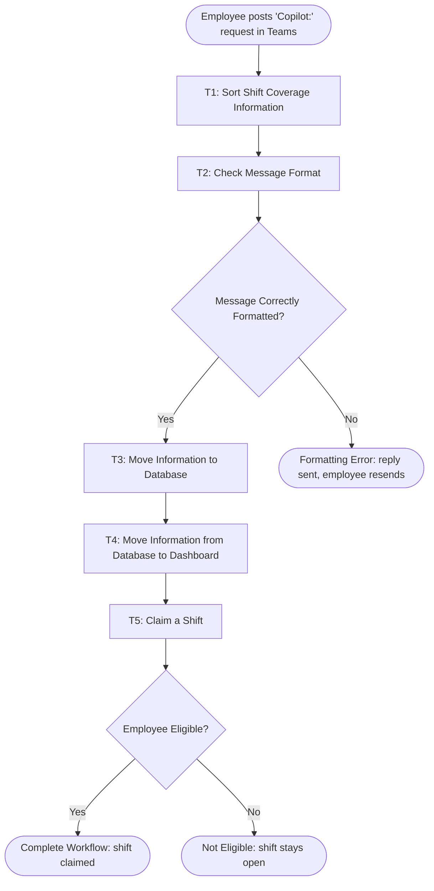

# Workflow of Tasks

## 1. Workflow Goal

This workflow supports the goal in our completed [team charter](https://github.com/arlowe928-lab/BUS4498_Team_Build-/blob/main/README.md). The workflow coordinates Sort Shift Coverage Information, Check Message Format, Move Information to Database, Move Information from Database to Dashboard, and Claim a Shift. Its intended result is: every coverage request posted in the team chat shows up as an open shift on the ShiftSpace dashboard, and an eligible employee claims it.

## 2. Workflow Trigger

An employee posts in the Microsoft Teams group chat: "Copilot: I need a shift covered: date (MM/DD/YYYY), shift time (hh:mm am/pm - hh:mm am/pm), reason for coverage (school, personal, family, or other)"

## 3. Completion Condition at Runtime

The shift is marked claimed on the ShiftSpace dashboard, and the requesting employee and the Manager are notified in Teams.

## 4. General Workflow

The workflow starts when an employee posts a coverage request in the Microsoft Teams group chat that begins with "Copilot:".

T1 · Sort Shift Coverage Information: Copilot reads the message and pulls the employee's first name and last initial, shift date, shift time, and reason for coverage (school, personal, family, or other). It converts the date to YYYY-MM-DD.

T1 routes to T2 · Check Message Format, where ShiftSpace checks every field against the format rules.

T2 routes to D1 · Message Correctly Formatted?

- If yes, D1 routes to T3 · Move Information to Database, where ShiftSpace saves the request to the `shift_requests` table in our Supabase (PostgreSQL) database with the status "open." T3 routes to T4 · Move Information from Database to Dashboard, where the shift appears on the dashboard page in the ShiftSpace app.
- If no, D1 routes to STOP1 · Formatting Error. ShiftSpace replies in the Teams chat with the correct format and what was missing. This run ends. When the employee resends the request, a new run starts at T1.

T4 routes to T5 · Claim a Shift. An employee signs in to the dashboard and clicks Claim on an open shift. D2 · Employee Eligible? checks the eligibility rules in the T5 specification.

- If yes, ShiftSpace marks the shift claimed and notifies the requesting employee and the Manager in Teams. The workflow routes to END · Complete Workflow.
- If no, D2 routes to STOP2 · Not Eligible. The dashboard tells the employee why they can't claim the shift, and the shift stays open for others.

## 5. Exception Handling

- If any task fails after its retries, ShiftSpace flags the record and notifies the Manager in Teams. No task retries forever or skips ahead.
- If a shift is still open 24 hours before it starts, ShiftSpace notifies the Manager in Teams so they can find coverage.
- Only the Manager can edit or remove a shift record.

## 6. Workflow Diagram

